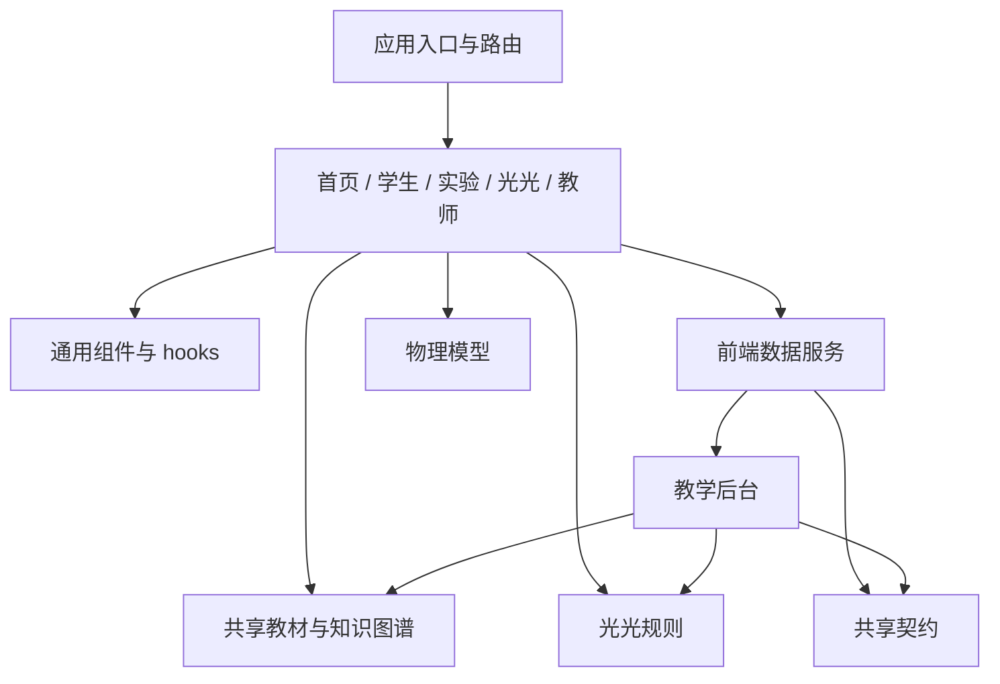

# 平台代码架构

本文件描述 V2 主工程的源码组织。日常功能开发在这里进行，工作区外围的教材、论文副本和桌面封装工程分别维护。

第一次阅读可先看更短的[代码导览](代码导览.md)。

本轮网站修复沿用现有边界：学生页内导航辅助函数在 `features/student/components/scrollToStudentSection.ts`，麦克风请求与资源所有权在 `features/experiments/sound/microphoneCapture.ts`，引导偏好容错在 `shared/components/pageIntroductionStorage.ts`。页面负责显示与操作，资源控制器不依赖 React；没有新增后台或第二套身份协议。验证见[第三十阶段记录](ACCEPTANCE_STAGE_30.md)。

## 工程结构

```text
初中物理虚拟实验平台_V2/
├── apps/
│   ├── web/src/
│   │   ├── app/                    路由组合与页面渲染测试
│   │   ├── features/
│   │   │   ├── home/               平台首页
│   │   │   ├── student/            学生首页、任务入口、记录本、课本图鉴
│   │   │   │   ├── pages/
│   │   │   │   └── components/
│   │   │   ├── experiments/        六大领域实验
│   │   │   │   ├── catalog/        非光学实验目录、教材说明与公式标签
│   │   │   │   ├── optics/         光学实验、生活应用、2D/3D视图与光具座
│   │   │   │   ├── sound/          声学实验
│   │   │   │   ├── mechanics/      力学实验
│   │   │   │   ├── circuit/        电学与电磁实验
│   │   │   │   ├── thermal/        热学实验
│   │   │   │   ├── measurement/    质量、体积和密度实验
│   │   │   │   └── shared/         实验控件、证据展示、全屏和任务上下文
│   │   │   ├── assistant/         光光面板、状态、实验桥接
│   │   │   │   └── tutorials/      教程流程、聚光提示、语音选择
│   │   │   ├── high-school/        独立高中实验室
│   │   │   │   ├── pages/          课程目录与统一工作台
│   │   │   │   ├── components/     装置图、按需加载的3D、图表与导航
│   │   │   │   │   ├── expanded/   新增实验的领域分发与共用几何
│   │   │   │   │   ├── flagship/   单摆、碰撞、电表、折射的器材与操作面板
│   │   │   │   │   ├── showcase/   首页轻量模型展台、独立预览时钟与局部样式
│   │   │   │   │   └── cosmos/     首页宇宙意象、投影绘制与独立动画生命周期
│   │   │   │   ├── styles/         高中主题令牌，不修改初中全局样式
│   │   │   │   ├── experiments/    轨迹、读数格式与独立记录存储
│   │   │   │   └── assistant/      柯基力力形象与对话界面
│   │   │   └── teacher/            教师工作台、账号、班级与课例
│   │   │       ├── sections/       总览、班级、备课、课堂、报告
│   │   │       └── components/     教师端共用展示组件
│   │   ├── shared/                 跨功能的基础组件与 hooks
│   │   ├── data/                   API客户端、本地存储、任务事件同步
│   │   ├── styles/                 按界面领域组织的样式
│   │   └── main.tsx                浏览器启动入口
│   ├── api/                        Node教学后台与检索服务
│   └── optics-research/            光学论文研究应用
├── packages/
│   ├── physics/src/domains/        初中分领域的物理计算
│   ├── physics/src/highSchool/     高中独立模型、参数定义与数值测试
│   ├── harness/                    证据判定、概念模型、对话与教程规则
│   ├── knowledge/                  教材知识与知识图谱
│   └── contracts/                  共享类型和数据约定
├── scripts/                        启停、构建、架构检查和验收脚本
└── config/                         光光服务及检索评价配置
```

## 开发部分

| 工作内容 | 首先查看 | 边界 |
| --- | --- | --- |
| 首页与整体界面 | [HomePage](../apps/web/src/features/home/HomePage.tsx)、[应用路由](../apps/web/src/app/App.tsx)、[基础组件](../apps/web/src/shared/) | 负责入口、页面组合与通用界面 |
| 学生实验空间 | [学生页面](../apps/web/src/features/student/pages/)、[实验目录](../apps/web/src/features/experiments/) | 学生资源与实验实现分别维护；每个实验有独立文件 |
| 高中实验室 | [高中功能目录](../apps/web/src/features/high-school/)、[高中模型](../packages/physics/src/highSchool/)、[课程目录](../packages/knowledge/src/highSchool/catalog.ts) | 页面、计算与教材依据独立；筹备实验不显示为已开放 |
| 光光智能助手 | [助手入口](../apps/web/src/features/assistant/HarnessRuntime.tsx)、[助手规则包](../packages/harness/) | React界面、装置事件桥接与纯规则分层 |
| 教师教学空间 | [教师工作台](../apps/web/src/features/teacher/TeacherDashboard.tsx)、[分区页面](../apps/web/src/features/teacher/sections/) | 账号、课例、课堂与报告按职责组织 |
| 物理仿真核心 | [物理计算包](../packages/physics/src/) | 数值计算与证据分析独立于React、浏览器及后台 |
| 数据与后台 | [前端数据层](../apps/web/src/data/)、[API后台](../apps/api/src/)、[契约包](../packages/contracts/) | 负责请求、存储、鉴权、同步及教学数据 |

## 依赖方向



- `packages/*` 不引用 `apps/*`，不把页面实现作为共享能力的依赖。
- 后台不读取网页源码；知识检索通过 `@physics-lab/knowledge/graph` 和 `@physics-lab/knowledge/textbook` 读取数据。
- `shared/` 只包含基础界面；需要实验状态、账号或任务数据的组件放入对应功能目录。
- `shared/hooks/useSimulationClock.ts` 提供与物理领域无关的固定步长时钟，初中斜轨与高中工作台共用；终点钳制到精确实验时长，页面隐藏时暂停。具体位移、速度和测量完成判定仍归属实验模型/页面。
- `data/` 不引用页面和组件，功能页面通过数据服务读写记录。
- 实验通过 `assistant/tutorialBridge.ts`、`assistant/harnessStore.ts` 和 `useApparatusDomSync.ts` 与光光协作。
- 装置坐标映射放在对应实验目录的纯函数中（`buoyancyGeometry.ts`、`densityGeometry.ts`、高中 `components/sceneGeometry.ts`）；水面与刻度、浸入比例与物体位置、地面与球心使用同一映射，视图只消费计算结果。场景尺寸仍是示意尺寸，不作为额外物理测量。
- 热学加速演示的计时状态转换在 `thermal/thermalRunClock.ts`，React计时器在同目录hook；记录快照与读数精度在 `evaporationEvidence.ts`。这些是本实验操作与仪器逻辑，不放进通用物理公式包。
- 压强的可见压痕证据在 `mechanics/pressureEvidence.ts`，按显示精度判断变化，饱和读数不能证明继续加深。电磁铁通电、暂停、观察终点和保护状态由 `circuit/electromagnetRun.ts` 的纯状态转换统一管理，`useElectromagnetRun.ts` 只连接React计时器；历史观测与当前通电状态分开。折射的 `optics/shared/formatOpticsAngle.ts` 只格式化读数，不将显示近似值回写物理模型。
- `data/teacherSessionScope.ts` 管理固定教师通道的账号、学校、后台与登录代次，订阅身份事件和到期时间；`teacherApi.ts` 在请求前及响应返回后核对凭据。React操作守卫位于 `features/teacher/useTeacherSessionGuard.ts`，教师页面在发起动作和异步返回后再次核对，工作台按代次重建账号内容。本地解码只用于隔离，真正权限仍由后台验证；已发出的写请求可能完成，丢弃旧响应不等于撤销后台写入。
- 报告反馈的服务端逻辑位于`apps/api/src/learning-feedback.js`，通过单条条件INSERT追加`session_learning_feedback`及四段原文快照，不改`session_learning_records`。教师编辑、冲突核对与本标签内存草稿放在`features/teacher/TeacherFeedbackPanel.tsx`，学生按需读取放在`features/student/components/StudentLearningFeedback.tsx`。共用作者/版本/正文与受控原文展示位于`features/learning-feedback/LearningFeedbackList.tsx`，只接收数据和身份检查回调，不请求后台；领域展示不混入基础`shared/`组件。
- 声学试听生命周期在 `sound/tonePlayback.ts`，通过同目录 `useTonePlayback.ts` 接入React；浏览器音频对象、取消与恢复不进入物理公式包。串并联操作证据在 `circuit/circuitFaultEvidence.ts` 冻结前后装置条件与模型读数，界面和助手读取相同快照。
- 高中新增14项按领域放在`components/expanded/`，二维与三维分别实现，几何映射和接线共用纯模块；`expansionCatalog.ts`、`expandedModels.ts`、`expandedSimulation.ts`和`expandedMeasurementAnalysis.ts`负责参数、物理、输出与记录分析。`liliExpansion.ts`仅补充教学指引，页面仍通过统一上下文与模拟入口接入。
- 四个重点样板的器材、几何与学习面板集中于 `components/flagship/`，原领域入口只分发，不复制模型或父工作台。`ExperimentViewport`独立维护二维放大与三维相机选择；`sceneCamera.ts`只提供观察位置。切换观察不改参数、时钟或记录。`ExperimentReadings`将主要数值与更多状态分开展示，所有数值仍经过同一有效性格式化，见[第二十五阶段记录](high-school/STAGE_25_ACCEPTANCE.md)。
- 器材模式和整数计数由参数目录统一验证；表格及CSV按读数项目与单位共同建列。变压器仅在高中时钟包装层换算演示速率，模型、记录和课堂始终使用物理秒。
- 高中通过 `data/highSchoolContext.ts` 发布实验上下文给力力；`packages/harness/src/highSchool/lili.ts` 负责校验和本地引导，`apps/api/src/lili.js` 负责模型运行、身份隔离、限流和降级。力力不复用光光的会话与人格配置。
- 力力照片与来源记录位于 `apps/web/public/assets/lili/`；头像列表、受控展示、原SVG回退、轮换hook和控件都位于高中 `assistant/`。一个会话仅挂载一份 `useCorgiAvatarRotation`，入口与面板共用索引；图片路径使用BASE_URL。头像状态不进入对话请求、实验模型或教学记录，见[五图轮换记录](high-school/STAGE_29_LILI_PHOTO_AVATARS.md)。
- 高中记录的控制变量分组、拟合和相邻位置估速在 `packages/physics/src/highSchool/measurementAnalysis.ts`；`MeasurementAnalysisPanel.tsx` 选择关系并展示结论，`MeasurementPointTable.tsx` 展示输入读数、推算过程及原记录序号。区间速度保存来源记录与起止坐标，不用模型瞬时速度替代位置差；力力按学生指定的关系读取同一分析结果。
- `data/highSchoolRecordScope.ts` 统一高中档案身份，依赖 `teacherApi.ts` 的底层登录元信息与事件。页面、记录和力力共享当前归属；数据层不导入React界面。`measurementStorage.ts` 的v3仓库按归属保存，手动仓库在其内使用独立前缀；旧档案读接口不执行迁移或删除。
- 课堂文字报告使用独立的 `data/studentRecordScope.ts`，固定读取学生通道，不跟随高中仪器档案的教师/游客选择器。`learningRecordRepository.ts` 的v3键按后台、学校、学生、课堂会话及标签页组织；续签保留稳定键并使旧请求回调失效。`studentSessionSync.ts` 的活动指针与初中队列使用同一学生归属，最后一批回包后仍有本次会话事件时阻止归档。服务端鉴权独立于本机令牌解析。
- `data/legacyLearningRecords.ts` 只负责显式读取旧v2报告与生成原文备份；学生组件目录的 `LegacyLearningRecordPanel.tsx`、`OtherLearningRecordDrafts.tsx` 和 `recordCopyDownload.ts` 分别负责展示与下载。正常读取不迁移旧档案，异常和其他页草稿不自动覆盖正文。完整行为及并发限制见[第十五阶段记录](ACCEPTANCE_STAGE_15.md)。
- 课堂仓库为每次页面生命周期生成新草稿编号，不使用可被复制的sessionStorage编号。原页面草稿通过显式预览恢复，`restoreDraft()` 单次写入新操作编号并保留原CAS版本；失败不预先清稿。`data/unsavedLearningRecord.ts` 负责未落盘正文的本标签内存副本与关闭提醒，`UnsavedLearningRecordPanel.tsx` 负责查看、导出和恢复选择。报告编辑器统一检查来源及目标全文，任务中心检查内存正文后才允许归档；内存副本不冒充本机持久化。
- `measurementStorage.ts` 的 `retryPending()` 独立补写原编号的失败记录，不借新增记录触发，因此达到新增上限后仍可恢复。自动页面和手动仓库的动作守卫负责当前身份与可写性，存储层负责清空代次与失败缓存；普通读取不自动补写，只读档案不会因显示而执行这个写操作。
- 无法确认新增时的存储代次，记录进入独立 `recovery` 集合。`measurementStorage.ts` 的 `recoverPending(reviewToken)` 绑定目标代次及完整内容，显式按原编号恢复，保留未确认副本；不把未知状态当作真实 `initial`。`MeasurementRecoveryPanel.tsx` 共用预览、导出与再次确认；`manualMeasurementRepository.ts` 校验手动原始量，异常批次只提供备份。常规分析和力力只读 `records`，不读 `recovery`。这些机制没有把localStorage变成跨标签事务，详细边界见[第十二阶段记录](high-school/ACCEPTANCE_STAGE_12.md)。
- 弹簧的力与长度在 `packages/physics/src/highSchool/elasticity.ts` 计算，界面 `springSceneGeometry.ts` 只做固定刻度转换；`SpringDiagram.tsx` / `SpringApparatus3D.tsx` 分别渲染二维和三维，`SpringLoadControl.tsx`只提交载荷参数。三维公共Block/Rod/Label独立为`ScenePrimitives3D.tsx`，避免实验之间互相导入。课程目录测试位于knowledge包，以Node原生测试加入全量检查。
- `packages/knowledge/src/classroomExperiments.ts` 通过 `@physics-lab/knowledge/classroom` 提供21个初中与24个已开放高中入口。教师模板、`taskRoutes.ts`、后台创建校验读取同一注册表；高中筹备条目不进入课堂注册表。实验任务参数仍由学生进入任务时附加，不存入注册路径。
- 电容器的完整开关历史定义在`packages/contracts`，分段重放、能量与对数分组在`packages/physics/src/highSchool/capacitor.ts`及`measurementAnalysis.ts`。工作台持有本轮历史，`components/Capacitor*`只显示并提交切换意图；`experiments/capacitorEvidence.ts`校验过程及生成课堂来源。正常/待恢复档案、CSV与力力均保留完整历史，不用当前参数加全局时间推测旧过程，见[电容器设计](high-school/CAPACITOR_CHARGE_DESIGN.md)。
- 机械能运动与等时纸带位于`packages/physics/src/highSchool/mechanicalEnergy.ts`，六位置算术和观察窗口在同包`manualMeasurements.ts`。二维/三维共用`mechanicalEnergyGeometry.ts`显示映射；`MechanicalEnergyMeasurementPanel.tsx`组织选点和自主读尺。档案/课堂字段说明在`experiments/mechanicalEnergyEvidence.ts`，继续复用已有分区、重试、恢复和报告写入协议。
- `data/highSchoolClassroom.ts` 核对明确任务链接与真实学生会话，`HighSchoolClassroomPanel.tsx` 显示高中任务上下文；不读取全局残留活动会话。`ClassroomEvidencePicker.tsx` 通过 `classroomEvidenceSources.ts` 只读当前归属的正常自动/手动仓库，`classroomEvidence.ts` 生成完整文字预览并检查字段容量；确认后调用既有 `StudentLearningRecordPage` 编辑入口，由 `learningRecordRepository.ts` 统一负责版本与同步。没有第二套报告写入协议或自动上传原始附件。
- `studentSessionSync.ts` 的初中自动事件只接受已注册初中实验和明确匹配的任务URL。补传保留完整离线队列、每500条一批，只移除已确认发送ID；高中或未知会话旧队列留在原地，不改名挂到新的高中报告。
- 后台 `repositories.js` 对新建课例/任务/会话校验课堂注册表，教师任务写操作限制到本人班级。会话首次启动按db/任务/学生进程排队；SQLite用单条条件插入，PostgreSQL事务先锁任务行再重读。没有新增唯一约束或清理已有重复会话；真实PostgreSQL并发锁验收仍待完成。
- `app/` 组合各功能，功能模块不反向引用应用路由。
- `scripts/check-architecture.mjs` 自动检查上述基础边界、本地引用及静态运行时循环依赖；动态路由也检查目标是否存在。

后台启动的职责单独分层：`apps/api/src/server.js` 只读取配置和处理进程信号，`server-runtime.js` 管理数据库、检索、两位助手和 HTTP 服务的启动及清理；`database-initialization.js` 根据锁内读取的真实状态决定保留现库、初始化演示或创建首位管理员。`database.js` / `database-postgres.js` 各自负责事务、初始化锁、结构迁移和 SQL，不把演示或 bootstrap 配置当成覆盖已有账号的命令。适配器只返回脱敏后的实际初始化结果，启动日志不重新猜测结果。规则与首次配置见 [后台说明](../apps/api/README.md#首次初始化与普通重启)。

## 添加或修改实验

SQLite备份与恢复独立于产品初始化：`scripts/lib/sqlite-backup.mjs`只读源库，创建并校验独立备份，恢复仅进入新目录；`scripts/database-backup.mjs`提供显式命令行入口，`scripts/lib/platform-backup.mjs`按API配置选取启动前备份路径。不从备份工具导入并执行schema迁移或seed；参考[运维边界](backend/SQLITE_BACKUP_RECOVERY.md)。

1. 在 `features/experiments/` 对应领域中修改具体实验文件。公共的仪器读数、证据结论和操作提示使用该目录的 `shared/` 组件。
2. 非光学实验的名称、教材对应和说明在 `catalog/scienceCatalog.ts`；实验组件在 `scienceRegistry.tsx` 注册。`ScienceExplorePage.tsx` 负责领域导航和页面布局。
3. 光学目录和导览文案在 `optics/catalog.ts`；`OpticsExplorePage.tsx` 组合模块。光具座高级工具在 `optics/workbench/`，生活应用在 `optics/applications/`。
4. 新物理计算进入 `packages/physics/src/domains/` 对应领域，证据分析进入 `evidenceAnalysis.ts`。保持模型输入输出可独立测试。
5. 更新知识图谱、教材映射或光光证据规则时，分别修改 `packages/knowledge` 与 `packages/harness`。

`packages/physics/src/coreExperiments.ts` 保留原有导出入口，具体实现已拆入 `domains/`。现有调用和物理测试继续使用同一公共接口。

高中新增实验先进入 `packages/knowledge/src/highSchool/catalog.ts` 的筹备目录，附上教材来源与假设；独立数值模型和边界测试放在 `packages/physics/src/highSchool/`。完成装置显示、参数交互、图表和记录验收后再开放。模型计算不依赖 React、Canvas 或大模型；教学图示不能改变模型的几何与电路连接关系。

## 样式组织

高中深空主题位于 `features/high-school/styles/HighSchoolTheme.css`，首页与工作台样式分别保留在 `pages/HighSchoolHome.css`、`HighSchoolWorkbench.css`。力力是页面之外的独立浮层，使用自身 `assistant/LiliCosmicTheme.css`，不把高中深色令牌扩散到初中。精密读数和手动工作表保留局部浅色测量面。

首页 `components/cosmos/` 只负责概念视觉：`CosmicObservatory.tsx` 组织模式、输入、页面内展开和浏览器观察器，`cosmicGeometry.ts` 提供确定性点云、投影、视角读数与绘制尺寸上限，`cosmicPainter.ts` 绘制 Canvas2D，`cosmicLoop.ts` 管理30fps预算、暂停和释放。`CosmicStaticArt.tsx` 负责静态SVG降级，与Canvas共用投影和轨道分段。它不接入实验参数、档案、课堂或助手，不导入Three.js；下方 `showcase/` 继续使用正式纯物理函数提供可调参数的模型预览。实现边界见[第二十八阶段记录](high-school/STAGE_28_OBSERVATORY_UPGRADE.md)。

`styles/global.css` 是按顺序导入的清单。具体样式位于 `foundation`、`shared`、`home`、`student`、`experiments`、`assistant`、`teacher` 等目录。

同一名称后的数字表示原样式中的连续片段。文件导入顺序与 `@layer` 优先级共同决定覆盖关系；调整视觉时应修改对应文件，并检查响应式和覆盖规则。不要为整理文件名而随意重排导入。

教材图鉴和任务上下文的独立样式继续随组件按需导入。

## 验证方式

```bash
npm run architecture:check  # 依赖边界、引用与循环检查
npm run typecheck           # 全工作区类型与API语法检查
npm test                   # 模型、助手、后台、数据服务和页面渲染测试
npm run knowledge:evaluate # 知识检索评价集
npm run build              # 架构检查、生产构建、首页资源验收
npm run verify             # 执行完整检查流程
npm run quality:checkpoint # 同样检查并保存每阶段日志与结果，失败即停止
```

[页面渲染测试](../apps/web/src/app/routeRendering.test.tsx) 覆盖首页、学生资源、六大领域目录和实验、教师各分区。它等待异步模块加载，检查页面能否正确组合；Canvas和3D绘制使用测试替身。拖拽、动画、语音、麦克风和真实GPU显示仍需浏览器交互验收。

架构整理保留了原有路由、实验标识、存储键、后台接口和物理计算逻辑。后续新增的结构化实验档案使用独立接口与数据表，入口和保存流程见 [第一轮后端升级说明](LEARNING_RECORDS_V1.md)。

## 共点力实验的模块位置

第十六阶段将`force-composition`接入既有注册和课堂链路，无新增数据库表。`packages/physics/src/highSchool/forceComposition.ts`负责分量、独立试配残差及零向量语义，`measurementAnalysis.ts`负责固定两分力大小的R²–cosθ分组拟合。前端`ForceCompositionDiagram.tsx`和`ForceCompositionControl.tsx`负责拖动、键盘及预设；`forceCompositionGeometry.ts`只做指针与绘图坐标映射。`ForceCompositionApparatus3D.tsx`与`forceCompositionScene3D.ts`通过既有懒加载场景显示同一状态，不将Three.js引入首页。工作台一次更新幅角参数，记录表使用历史读数项目的并集，零力状态不会隐藏已有角度列。课程与助手分别留在knowledge/harness包，详见[模型设计](high-school/FORCE_COMPOSITION_DESIGN.md)和[第十六阶段验收](high-school/ACCEPTANCE_STAGE_16.md)。
